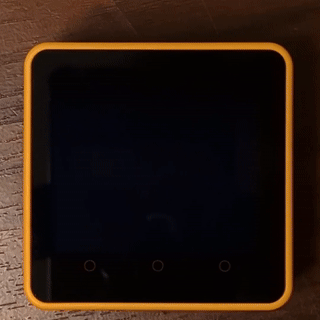

# Overview / 概要

A Delaunay diagram that dances. The m5core2_delaunay project is an interactive Delaunay diagram renderer for the [M5Stack Core 2](https://docs.m5stack.com/en/core/core2): touch the screen and watch the triangles ripple and re-form in real time.

\[日本語\]

躍動するドロネー図。m5core2_delaunayプロジェクトは、[M5Stack Core 2](https://docs.m5stack.com/en/core/core2)向けのインタラクティブなドロネー図描画プログラムです。画面に触れると、三角形が波紋のように広がり、リアルタイムで形を変えていく様子を楽しめます。

# Video / 動画



# Installation / インストール

1. Open https://burner.m5stack.com/QTBUN3 .

1. Click `Burn to device` button.

1. Click `Continue` button.

1. Click `Select COM` button.

1. Select `CP2104 USB to UART Bridge Controller` in a dialog.

1. Click `Connect` button.

\[日本語\]

1. https://burner.m5stack.com/QTBUN3 を開く。

1. `デバイスに書き込む` ボタンをクリックする。

1. `続行` ボタンをクリックする。

1. `COMを選択` ボタンをクリックする。

1. ダイアログで `CP2104 USB to UART Bridge Controller` を選択する。

1. `接続` ボタンをクリックする。

# Installation for developers / インストール（開発者向け）

1. Clone the repository:
    ```sh
    git clone https://github.com/cubic9com/m5core2_delaunay.git
    cd m5core2_delaunay
    ```

1. Install [Visual Studio Code](https://code.visualstudio.com/) if you haven't already.

1. Open the project using Visual Studio Code:
    ```sh
    code .
    ```

1. Install the `PlatformIO IDE` extension:
    - Go to the Extensions view (`Ctrl+Shift+X`).
    - Search for `PlatformIO IDE` and install it.

1. Open PlatformIO Home:
    - In the left Activity Bar, click the PlatformIO icon.
    - In the left Primary Sidebar, go to `QUICK ACCESS > PIO Home > Open`.

1. Open the project:
    - In the right Editor Group, click `Open Project` in the `PIO HOME` tab.
    - Select the cloned `m5core2_delaunay` project folder.

1. Build and upload the project:
    - In the left Primary Sidebar, go to `PROJECT TASKS > m5stack-core2 > General > Upload`.

\[日本語\]

1. リポジトリをクローンします:
    ```sh
    git clone https://github.com/cubic9com/m5core2_delaunay.git
    cd m5core2_delaunay
    ```

1. まだインストールしていない場合は、[Visual Studio Code](https://code.visualstudio.com/) をインストールします。

1. Visual Studio Code でプロジェクトを開きます:
    ```sh
    code .
    ```

1. `PlatformIO IDE` 拡張機能をインストールします:
    - 左サイドバーの「拡張機能」ビュー (`Ctrl+Shift+X`) を開きます。
    - `PlatformIO IDE` を検索してインストールします。

1. PlatformIO Home を開きます:
    - 左のアクティビティバーで PlatformIO アイコンをクリックします。
    - 左のメインサイドバーから `QUICK ACCESS > PIO Home > Open` を選択します。

1. プロジェクトを開きます:
    - 右のエディターグループ内の `PIO HOME` タブで `Open Project` をクリックします。
    - クローンした `m5core2_delaunay` プロジェクトフォルダーを選択します。

1. プロジェクトをビルド＆アップロードします:
    - 左のメインサイドバーから `PROJECT TASKS > m5stack-core2 > General > Upload` を選択します。

# License / ライセンス

Copyright (C) 2025, cubic9com All rights reserved.

This project is licensed under the MIT license.

See the `LICENSE` file for details.
